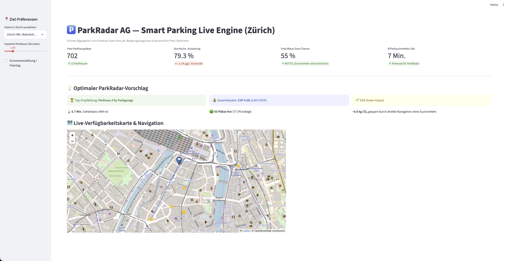

# ParkRadar AG — Smart Parking Live Engine & ML Predictor (Switzerland)

 A real-time smart parking aggregation, predictive machine learning, and dynamic pricing engine designed for Swiss metropolitan areas (Zurich pilot).

 

## Business Context & Vision

 ParkRadar AG addresses urban traffic congestion during the critical last 500 meters of urban navigation. Studies show up to 30% of downtown traffic is caused solely by drivers searching for open parking spaces. 

 ParkRadar combines **Swiss Open Data APIs**, **ML-driven occupancy probability forecasting**, and an **ESG green-impact calculator** to direct drivers directly to the most cost-effective and available parking option.

---

## Architecture & Features

 ```text
 [Open Data Zurich API] ──┐
                          ├──> [Data Aggregator] ──> [Price & Walk Optimizer] ──> [Streamlit UI / Folium Map]
 [Weather / Event Flags]  ──┘          │
                                        ▼
                        [ML RandomForest Regressor]
                        (Street Parking Probability
 ```

 - Open Data Ingestion: Aggregates real-time occupancy rates, capacities, and coordinates across major car parks in Zurich.
 - Predictive Engine (ML): Scikit-learn Random Forest model trained on urban traffic cycles (hour, weekday, CBD distance, and events) predicting street-parking (blue/white zones) availability.
 - Dynamic Price & Distance Optimizer: Multi-objective scoring balancing walk time, hourly tariffs (CHF), and live availability risk.
 - ESG Metric Tracking: Calculates saved vehicle emissions ($\sim 1.2\text{ kg CO}_2$ per eliminated search cycle).

## Setip & Running

 ```bash
 # 1. Clone repository
 git clone [https://github.com/Seyo2412/parkradar-engine.git](https://github.com/Seyo2412/parkradar-engine.git)
 cd parkradar-engine

 # 2. Virtual environment & dependencies
 python3 -m venv .venv
 source .venv/bin/activate
 pip install -r requirements.txt

 # 3. Launch live dashboard
 streamlit run src/app.py
 ```

 Run Automated Tests

 ```bash
 pytest tests/
 ```